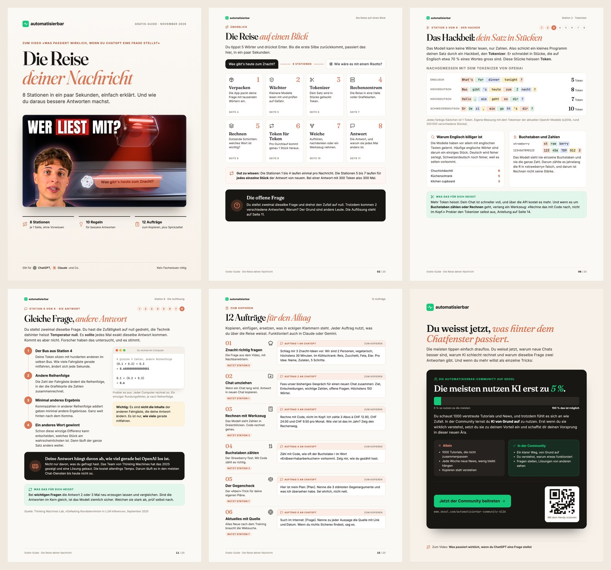

# Die Reise deiner Nachricht: der Gratis-Guide

Zum Video **«Was passiert wirklich, wenn du ChatGPT eine Frage stellst»**

## 📥 [Guide herunterladen (PDF, 20 Seiten)](Die-Reise-deiner-Nachricht.pdf)

Das steht drin:

- **Die 8 Stationen deiner Nachricht,** je eine Seite: Verpacken, Wächter, Tokenizer, Rechenzentrum, Rechnen, Token für Token, Weiche, Antwort.
- **Was das für dich heisst:** zu jeder Station ein Kasten mit dem praktischen Nutzen.
- **10 Regeln für bessere ChatGPT-Antworten.**
- **3 Vorlagen:** Chat-Umzug, eigene Anweisungen, Gegencheck.
- **Tokenizer selbst ausprobieren,** mit Messtabelle zum Ausfüllen.
- **12 Alltags-Aufträge zum Kopieren.**
- **Wenn es hakt, Spickzettel und Checkliste.**

---

👉 **Mehr in der automatisierbar-Community auf Skool:** https://www.skool.com/automatisierbar-community-6126

Lerne KI von Grund auf zu nutzen, statt 1000 verstreute Tutorials zu schauen.
